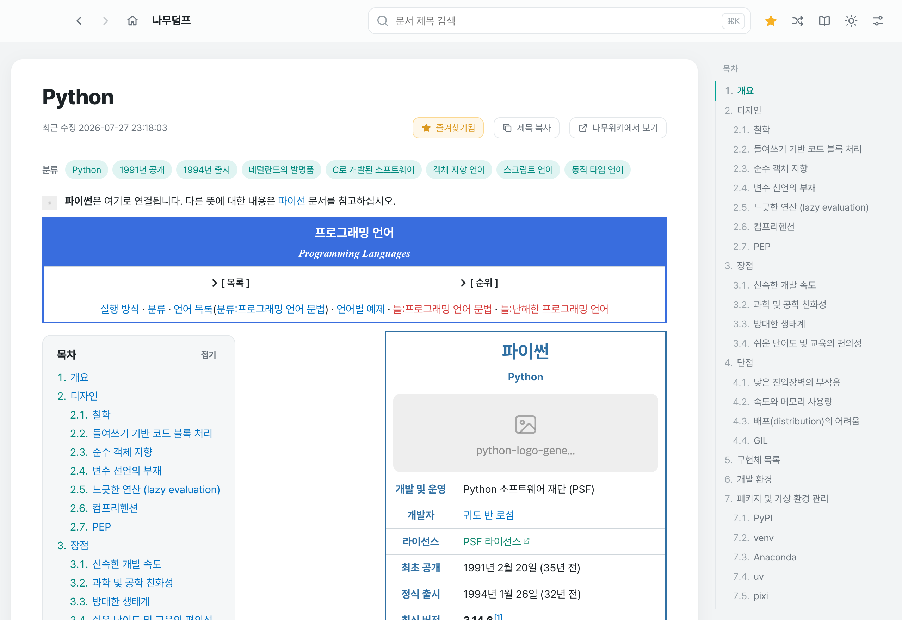

<p align="center">
  
</p>

<h1 align="center">나무덤프</h1>

<p align="center">
  <b>인터넷 연결 없이 읽는 나무위키 오프라인 덤프 뷰어</b><br>
  macOS, Windows, Linux 지원
</p>

<p align="center">
  
</p>

<p align="center">
  
</p>

---

## 주요 기능

- **원문 서식 재현**: 표 색상과 정렬, 다단 틀과 탭 전환, 글자 크기와 색상, 수식(KaTeX), 각주 말풍선, 문단 접기, 접기 상자 등 나무위키 고유의 문서 서식을 그대로 살려 보여 줍니다.
- **깔끔한 열람 화면**: 덤프 데이터에 섞여 있는 파워링크 등 광고 영역과 불필요한 요소를 자동으로 걸러 냅니다.
- **빠른 제목 검색**: 검색어를 입력하는 즉시 자동 완성 목록을 제안하며, 검색어로 시작하는 문서와 검색어가 포함된 문서를 나누어 빠르게 찾아 줍니다.
- **편리한 탐색과 보관함**: 문서 내 목차와 오른쪽 고정 목차, 본문 내 검색, 최근 본 문서와 즐겨찾기 보관함, 읽던 위치와 문단 접기 상태 복원을 지원합니다. 없는 문서로 연결된 링크는 빨간색으로 구분해 표시하고 비슷한 제목의 문서를 제안합니다.
- **맞춤 화면 설정**: 시스템 설정 연동 라이트 모드와 다크 모드(나무위키 다크 모드 색상 지원), 기본 내장된 Pretendard 및 시스템 설치 글꼴 선택, 글자 크기와 본문 너비 조절을 지원합니다.
- **새 버전 알림**: 시작할 때와 일정 시간마다 GitHub에서 새 버전을 확인해 변경 내용과 함께 알려 줍니다. 앱 버전 외의 정보는 전송하지 않으며, 설정에서 끌 수 있습니다.
- **네이티브 사용성**: macOS에서는 트랙패드와 매직 마우스 좌우 쓸기 제스처로 이전 및 다음 문서 미리 보기 전환과 macOS 26 이상 Liquid Glass 앱 아이콘을 지원하며, 모든 운영체제에서 마우스 옆 버튼(뒤로, 앞으로)과 키보드 단축키를 지원합니다.

> 나무덤프는 나무위키 운영사(umanle S.R.L.)와 관련 없는 비공식 프로그램입니다.

---

## 지원하는 덤프 파일 규격

나무덤프는 **2026년 8월 기준 나무위키 오프라인 덤프(`namu-html.sqlite`)** 규격에 맞춰 제작되었습니다.

- **지원 파일**: `namu-html.sqlite` (파싱된 HTML 본문이 포함된 SQLite3 데이터베이스, 약 72GB)
- **미지원 파일**: `namu-md.sqlite` 등 HTML 본문(`html` 컬럼) 없이 마크다운 텍스트만 포함된 파일이나 공식 JSON/XML 덤프는 열 수 없습니다.
- 이 저장소는 뷰어 프로그램만 배포하며 덤프 파일은 포함하지 않습니다.
- 처음 실행할 때 덤프 파일을 한 번 선택하면 다음 실행부터는 자동으로 연결되며, 외장 드라이브에 보관된 파일도 원본 수정 없이 읽기 전용으로 바로 열 수 있습니다.

---

## 다운로드 및 설치

[최신 릴리스](../../releases/latest)에서 운영체제와 프로세서 구조에 맞는 설치 파일을 내려받습니다.

| 운영체제 | 지원 구조 | 설치 파일 |
|---|---|---|
| **macOS 12 이상** | Apple Silicon (arm64) | `namudump-<버전>-mac-arm64.dmg` |
| **Windows 10, 11** | x64, Arm64 | `namudump-<버전>-win-x64-setup.exe`<br>`namudump-<버전>-win-arm64-setup.exe` |
| **Linux** | x64, arm64 | `namudump-<버전>-linux-x86_64.AppImage`<br>`namudump-<버전>-linux-arm64.AppImage` |

### macOS

1. `.dmg` 파일을 열고 **나무덤프**를 **응용 프로그램** 폴더로 끌어다 놓습니다.
2. 인증서 서명이 없는 앱이므로 첫 실행 시 경고가 나타나면 아래 방법으로 허용해 주세요.
   - **"확인되지 않은 개발자" 경고가 뜰 때**: **시스템 설정 → 개인정보 보호 및 보안** 아래쪽에서 **그래도 열기**를 누릅니다.
   - **"손상되었기 때문에 열 수 없습니다" 경고가 뜰 때**: 터미널에서 아래 명령어를 한 번 실행한 뒤 다시 엽니다.

```bash
xattr -dr com.apple.quarantine /Applications/NamuDump.app
```

### Windows

설치 파일(`-setup.exe`)을 실행합니다. SmartScreen 경고("Windows의 PC 보호")가 나타나면 **추가 정보 → 실행**을 누릅니다. 별도 선택 화면 없이 현재 사용자 계정(`%LOCALAPPDATA%\Programs`)에 설치된 뒤 바로 실행됩니다. 새 버전도 같은 방법으로 설치 파일을 실행하면 덮어 설치되며, 설정과 기록은 그대로 유지됩니다.

### Linux

내려받은 AppImage 파일에 실행 권한을 부여한 뒤 바로 실행합니다.

```bash
chmod +x namudump-*.AppImage
./namudump-*.AppImage
```

---

## 단축키

macOS에서는 `⌘`, Windows와 Linux에서는 `Ctrl` 키를 사용합니다.

| 단축키 | 동작 |
|---|---|
| `⌘K` 또는 `/` | 문서 제목 검색창으로 이동 |
| `⌘[` , `⌘]` (`Alt+←`, `Alt+→`) | 뒤로 이동, 앞으로 이동 |
| `⌘⇧H` | 홈 화면으로 이동 |
| `⌘F` | 문서에서 찾기 |
| `⌘R` | 무작위 문서 열기 |
| `⌘D` | 즐겨찾기 추가 및 해제 |
| `⌘Y` | 보관함(최근 본 문서, 즐겨찾기) 열기 |
| `⌘+` , `⌘-` , `⌘0` | 글자 크게, 작게, 기본 크기로 초기화 |
| `⌘O` | 다른 덤프 파일 열기 (macOS) |
| `⌘N` | 새 창 열기 (macOS) |
| `⌘,` | 설정 열기 |
| `Esc` | 찾기 막대, 각주 말풍선, 보관함, 설정 닫기 |

---

## 참고 사항 및 개인정보 보호

- **오프라인 열람 한계**: 덤프에 이미지 원본 파일이 포함되어 있지 않으므로 이미지 자리에는 원래 크기의 영역과 대체 설명(alt)만 표시합니다. 또한 본문 전문 검색, 역링크, 문서 역사, 토론은 지원하지 않으며, 최신 문서는 문서 상단의 **나무위키에서 보기** 버튼으로 확인할 수 있습니다.
- **데이터 보관**: 설정과 방문 기록, 즐겨찾기는 사용자 기기에만 저장되며 외부로 전송되지 않습니다.
  - macOS: `~/Library/Application Support/NamuDump`
  - Windows: `%APPDATA%\NamuDump`
  - Linux: `~/.config/NamuDump`
- **외부 네트워크 연결**: 문서 안에 포함된 YouTube 동영상의 썸네일 표시(`i.ytimg.com`), 동영상 재생, 외부 링크 열기를 실행할 때만 인터넷 연결을 사용합니다. 오프라인 상태에서는 검은 배경으로 표시되며 그 밖의 외부 리소스 요청은 차단됩니다.

---

## 라이선스 및 기여자

- **프로그램 코드**: [MIT License](LICENSE) (© 2026 Hishydrogen)
- **문서 콘텐츠**: 나무위키 기여자 작성, [CC BY-NC-SA 2.0 KR](https://creativecommons.org/licenses/by-nc-sa/2.0/kr/) (비영리 목적 이용 가능)
- **포함된 오픈소스**: [Electron](https://www.electronjs.org) (MIT), [KaTeX](https://katex.org) ([MIT](web/katex/LICENSE)), [Pretendard](https://github.com/orioncactus/pretendard) ([SIL OFL 1.1](web/fonts/Pretendard-LICENSE.txt))
- **개발 문서 및 변경 내역**: [DEVELOPMENT.md](DEVELOPMENT.md), [CHANGELOG.md](CHANGELOG.md)
- **기여자**: [@hishydrogen](https://github.com/hishydrogen), [Claude](https://github.com/claude), [Gemini](https://github.com/gemini-code-assist)
